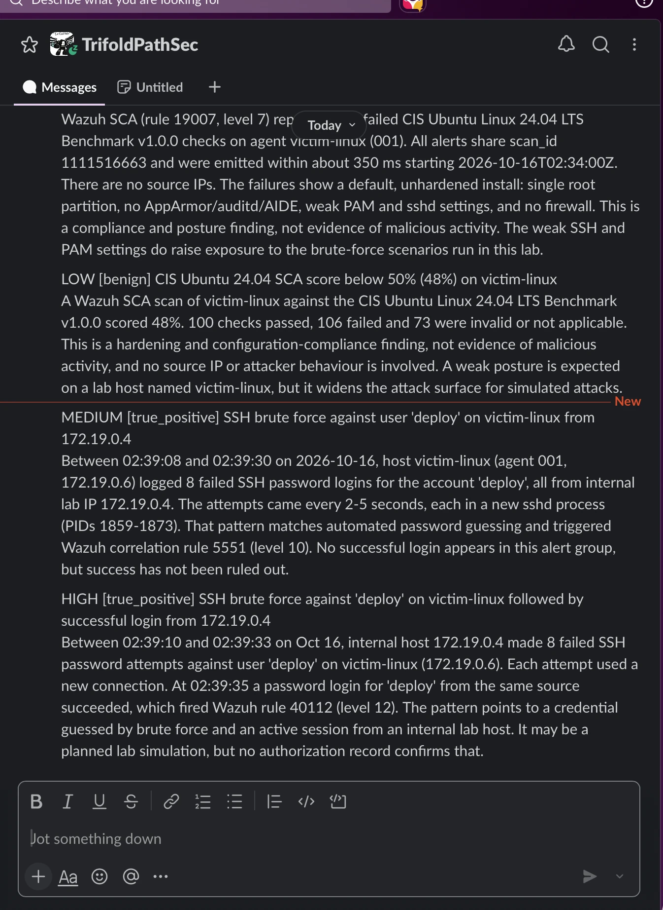
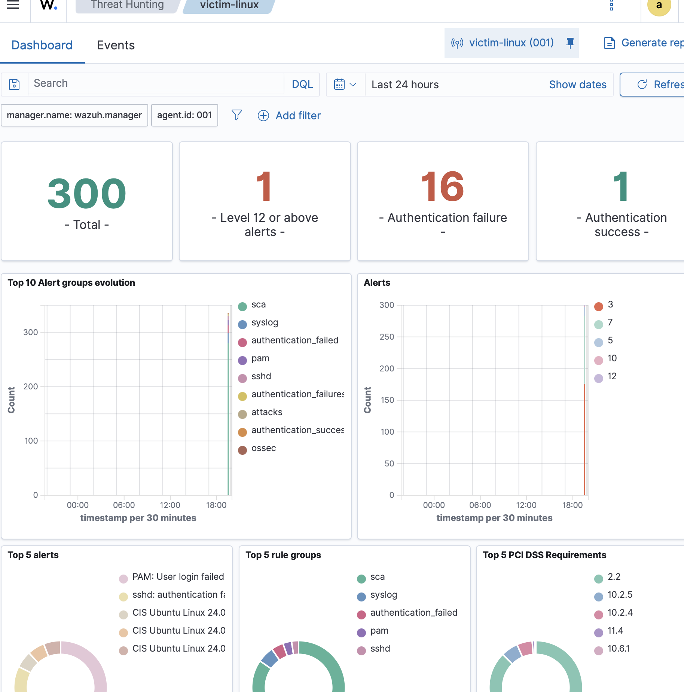
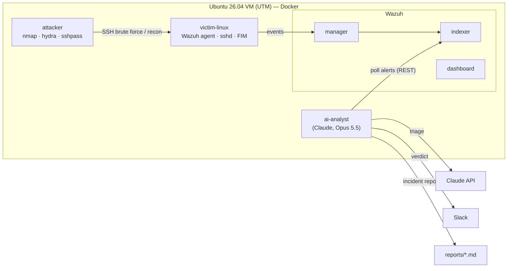

# kshrike-ai-soc-analyst

**Built an AI-powered SOC analyst that watches a Wazuh SIEM, correlates alerts into cases, and triages them with Claude — attack → detection → AI verdict → Slack alert — then proved it end to end against a live SSH brute force.**

*By @alex_mh · TrifoldPathSec · October 2026*

| Stage | Result |
|---|---|
| **Attack** | SSH brute force against `deploy`, 8 failures + success, from an internal lab host |
| **Detection** | Wazuh rule **40112** (level 12) — *multiple authentication failures followed by a success* |
| **AI triage** | Claude verdict **HIGH / true_positive**, mapped to MITRE **T1110** + **T1078** |
| **Response** | Structured incident report written to disk + alert delivered to Slack |





---

## What it is

A self-contained homelab where **Claude acts as a Tier 1/2 SOC analyst**. It polls a
Wazuh SIEM for new high-severity alerts, groups them into cases, enriches them with
threat intel, and asks Claude for a triage verdict — true/false positive, severity,
MITRE ATT&CK mapping, evidence, and recommended response actions — then writes an
incident report and notifies Slack. Attack scenarios generate the detections to test
it against.

The point is not just detection (Wazuh does that) but **triage**: turning a pile of
raw alerts into an analyst-quality verdict and a next action, automatically.

## Lab setup



- **SIEM:** Wazuh manager + indexer + dashboard (official `wazuh-docker`, pinned 4.14.9).
- **Endpoint:** Ubuntu `victim-linux` container with a Wazuh agent, sshd, and
  file-integrity monitoring — intentionally weak (password SSH, a guessable `deploy`
  account, passwordless sudo).
- **Attacker:** a container with `nmap`/`hydra`/`sshpass` running the scenarios.
- **AI analyst:** a Python service (`soc_analyst/`) calling Claude (`claude-opus-5-5`).
- Everything runs on one Docker network inside an Ubuntu VM in UTM; only the Wazuh
  dashboard (`443`) is reached from the host.

## How the AI analyst works

1. **Poll** — query the Wazuh indexer for alerts above a rule-level threshold, newer
   than startup.
2. **Correlate** — group alerts by host + rule group + source IP into one case, so a
   whole brute-force burst is triaged once, not per line.
3. **Enrich** — add AbuseIPDB / VirusTotal context for public IPs (skipped cleanly
   without keys).
4. **Triage** — send the case to Claude (adaptive thinking) and get back a structured
   JSON verdict: severity, verdict, confidence, MITRE mapping, evidence, actions.
5. **Report + notify** — write a Markdown incident report; alert Slack for
   critical/high cases. Cost is bounded by a per-hour triage cap and case-level
   de-duplication.

## Quick start

Inside the Ubuntu VM, with Docker installed:

```bash
./scripts/setup.sh                 # clone Wazuh, generate certs, raise vm.max_map_count, make .env
nano .env                          # add ANTHROPIC_API_KEY (and optionally a Slack webhook)
docker compose up -d --build       # bring up all six services
```

Open the dashboard from the host at `https://<vm-ip>/` (admin / SecretPassword), then
generate a detection:

```bash
docker compose exec attacker bash /scenarios/01_ssh_bruteforce.sh victim
docker compose logs -f ai-analyst                      # watch the triage
cat reports/$(ls -t reports | head -1)                 # read Claude's incident report
```

Scenarios: `01_ssh_bruteforce.sh` (credential access), `02_persistence_cron.sh`
(persistence, trips FIM), `03_recon_nmap.sh` (discovery).

Full configuration, Slack/Discord setup, and troubleshooting: **[SETUP.md](SETUP.md)**.

## Detection in action

The brute-force run produced exactly the chain the lab was built to prove:

```
Wazuh:   rule 40112 (level 12) — multiple authentication failures followed by a success
analyst: triaging case victim-linux-syslog-172.19.0.4 (9 alerts, level 12)
         -> high / true_positive
```

Claude's Slack alert (abridged):

> **HIGH [true_positive] SSH brute force against 'deploy' followed by successful
> login.** 8 failed SSH password attempts, each in a new sshd process, then a
> successful password login from the same source — fired Wazuh rule 40112 (level 12).
> Points to a credential guessed by brute force and an active session. *May be a
> planned lab simulation, but no authorization record confirms that.*

It also correctly down-ranked the noise: the Wazuh **SCA** (CIS benchmark) findings
were triaged **LOW / benign** — *"a compliance and posture finding, not evidence of
malicious activity"* — while still noting the weak posture widens the attack surface.
That separation of real attack from compliance noise is the analyst skill the lab set
out to demonstrate.

## Lessons learned

The build worked; getting the victim's SSH logs into Wazuh took the real debugging —
three stacked, independent bugs, each of which produced the *same* silent symptom
("logs exist but Wazuh shows zero detections"):

1. **File ownership.** rsyslog drops privileges to the `syslog` user, but a `touch`
   in the entrypoint created `auth.log` owned by `root` — so rsyslog silently could
   not append to it. Create the log owned by the user rsyslog runs as.
2. **Startup ordering.** sshd was starting before rsyslog, so it logged to a
   `/dev/log` socket that did not exist yet. Start rsyslog first.
3. **Timestamp format.** Ubuntu's rsyslog defaults to high-precision ISO8601
   timestamps, which Wazuh's syslog decoder cannot parse — the lines arrived but
   never decoded. Force `RSYSLOG_TraditionalFileFormat`.

The meta-lesson: **"logs are arriving" is not "logs are being decoded."** Verify at
each hop — file written → correct owner → correct format → decoder matches → rule
fires → alert indexed — instead of assuming the pipe is whole.

Other gotchas that cost time, now documented in the repo:
- **Agent re-enrollment.** Rebuilding the victim left a stale agent registration; the
  manager rejects the duplicate name until the old one is removed (`manage_agents -r`).
- **Stateful detection rules.** Wazuh's brute-force rules are frequency-based and stop
  re-firing under rapid repeated test attacks — wait for the window to reset, or test
  on a fresh stack.

## Trade-offs

| Choice | Cost | When I would change it |
|---|---|---|
| Triage a correlated **case**, not every alert | A burst is one verdict, not N | Per-alert triage only if each alert needs its own record |
| `MIN_RULE_LEVEL=7`, notify critical/high | Low-level events are logged but not triaged | Lower it for a demo, or for environments where level-5 matters |
| Claude Opus 5.5 at `medium` effort | A few dollars/month at lab volume | `high`/`xhigh` for harder incidents; a cheaper model for bulk |

## Limitations

- **Lab fidelity.** A single Linux victim on a Docker network; not a representative
  enterprise estate. The attacker source is an internal RFC1918 address, so IP
  reputation enrichment is a no-op here.
- **Not a replacement for a human analyst.** The verdict is a first-pass triage; it
  can be wrong, and it says so (confidence + "needs_review" fallback).
- **Cost scales with alert volume.** The per-hour cap and de-duplication keep it
  bounded, but a noisy source still spends tokens.

## Next steps

- [ ] Add Windows (Sysmon) and network (Suricata/Zeek) telemetry sources
- [ ] Case management: push verdicts into TheHive or DFIR-IRIS instead of flat files
- [ ] Active response: let the analyst recommend (and, gated, trigger) a Wazuh
      firewall-drop on a confirmed brute force
- [ ] Evaluate triage quality with a labelled alert set (precision/recall on
      true vs false positive)
- [ ] Map each verdict to MITRE ATT&CK navigator layers

---

*Part of the TrifoldPathSec lab series. Lab-only: isolated Docker network, intentionally
vulnerable host — keep it off any production or internet-facing network, and only run the
scenarios against the bundled `victim` container.*
